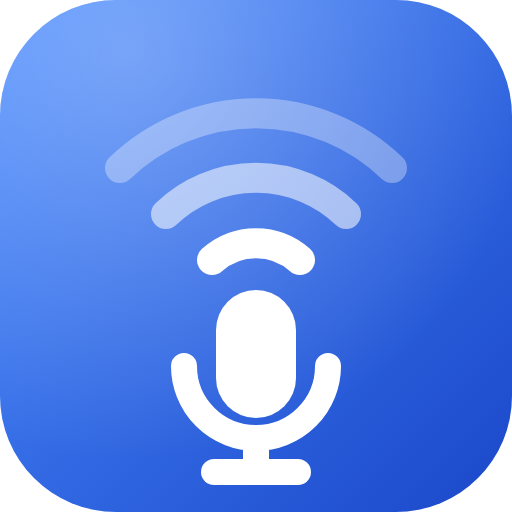

<p align="center">
  
</p>

<h1 align="center">MicHP</h1>

<p align="center">
  Use your Android phone as a wireless microphone for your Windows PC, over your home WiFi.<br>
  No internet, no account, no cables.
</p>

> **Status: beta.** Tested end to end by the author: the Android app on a real phone, the Windows
> installer (including the automatic VB-Cable install), and sound in other apps through **CABLE Output**.
> The sound is clear with almost no noticeable delay, and the mic volume can be adjusted.
> It was tested on one setup, so your router, phone or Windows version may behave differently.
> Bug reports are very welcome!

## What it does

Your phone's microphone becomes a microphone on your PC. Pick it in Discord, OBS, Zoom, games, or any app that
lets you choose a microphone.

```
 Phone mic ──(WiFi, UDP)──▶ MicHP on PC ──▶ virtual mic (VB-Cable) ──▶ Discord / OBS / Zoom
```

## Download and install (Windows)

1. Go to the **[Releases page](../../releases/latest)** and download **`MicHP-Setup.exe`**.
2. Double-click it and click **Install**.
   - It also installs **VB-Cable** (a free virtual microphone by VB-Audio) if you don't have it yet.
     Windows will ask for Administrator permission, and at the end you should **restart the PC**.
3. Open **MicHP** from the Start Menu or Desktop.
4. When Windows Firewall asks, allow it on **Private networks**.

## Install the phone app (Android)

1. On your phone, open the **[Releases page](../../releases/latest)** and download **`MicHP.apk`**.
2. Open the file. If Android asks, allow **Install from unknown sources** for your browser or file manager.
3. Open **MicHP** and allow the **microphone** and **notification** permissions.

Prefer to build it yourself? See **[android/README.md](android/README.md)**.

## How to use

1. PC: open **MicHP**. In Discord/OBS/Zoom, choose **CABLE Output** as the microphone.
2. Phone: open **MicHP** → tap **Turn On Mic** (yellow: *Mic Connecting..*).
3. PC: your phone's name appears → click **Connect**. The phone turns green: *Mic Online*.
4. Talk. The sound bar on the PC moves. Turn on **Hear yourself** to test (use a headset to avoid echo).

Both devices must be on the **same WiFi network** (not a guest network, VPN off).

More detail, a first-test checklist and troubleshooting: **[GUIDE.md](GUIDE.md)**.

## Good to know

- **Clear sound, low delay.** Audio is sent uncompressed (about 770 kbps), which is tiny for home WiFi and is
  why it sounds clean and stays in sync.
- **One phone at a time.** Connect the phone you want to use; to switch phones, connect the other one.
- **Home WiFi only.** Your phone and PC must be on the same network. The audio is not encrypted, so use it on
  a network you trust. You always have to click **Connect** on the PC first.
- **Windows and Android only** for now.
- Some routers have *AP isolation* (client isolation) turned on, which stops the phone from finding the PC.
  If that happens, see [GUIDE.md](GUIDE.md#5-troubleshooting).

## For developers

```
cd pc
python -m unittest discover -s tests -t . -v     # 63 tests
python -m michp_pc --no-audio                    # run the UI without audio output
python -m michp_pc.fake_phone --seconds 10       # fake phone, in another terminal
```

- [PROTOCOL.md](PROTOCOL.md): how the phone and PC talk to each other
- [docs/BLUEPRINT.md](docs/BLUEPRINT.md): design and architecture
- [AGENTS.md](AGENTS.md): project rules and conventions
- [pc/README.md](pc/README.md): running from source on Windows
- [PROGRESS.md](PROGRESS.md): status per checkpoint

**Releasing a new Windows installer:** push a tag, e.g. `git tag v1.0.0 && git push origin v1.0.0`.
The *Release* workflow builds `MicHP-Setup.exe` and attaches it to a GitHub Release automatically.

## License

[MIT](LICENSE). VB-Cable is a separate product by VB-Audio and is downloaded from their website, not
bundled in this repository; please respect its license.
