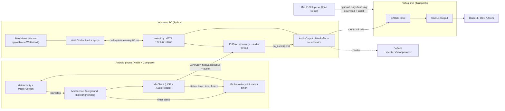
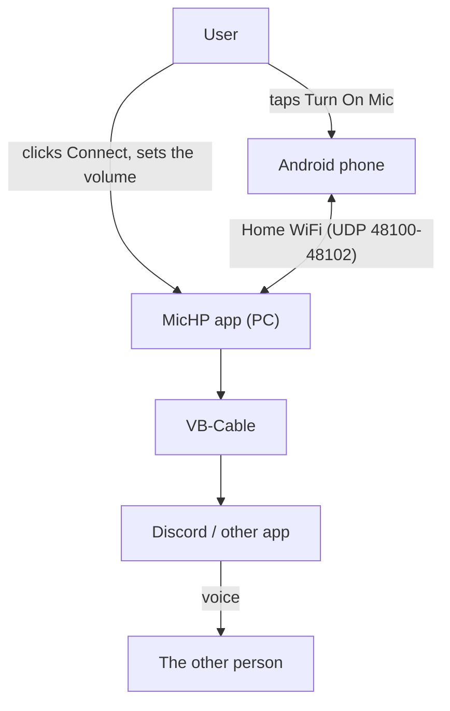
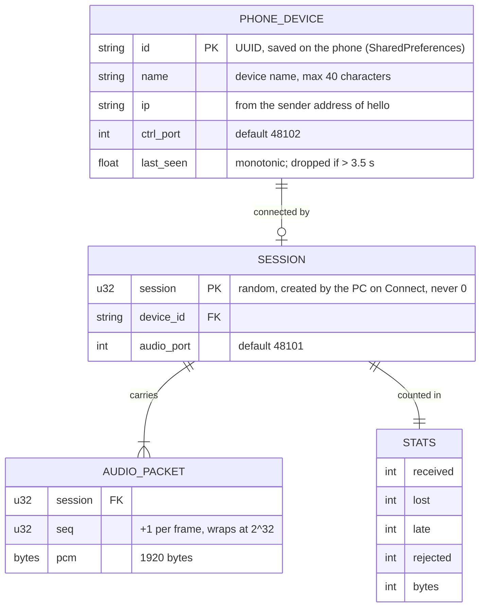
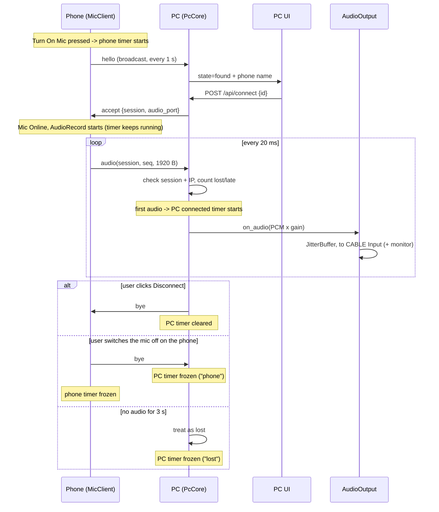
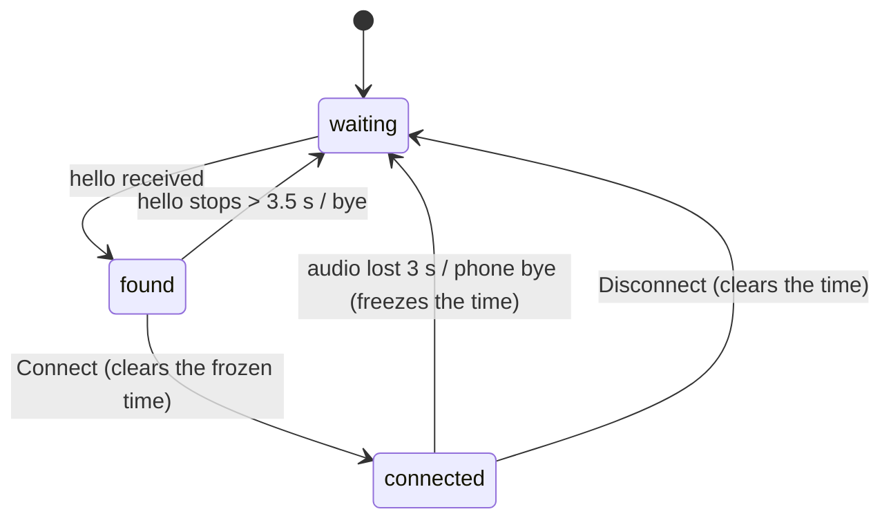
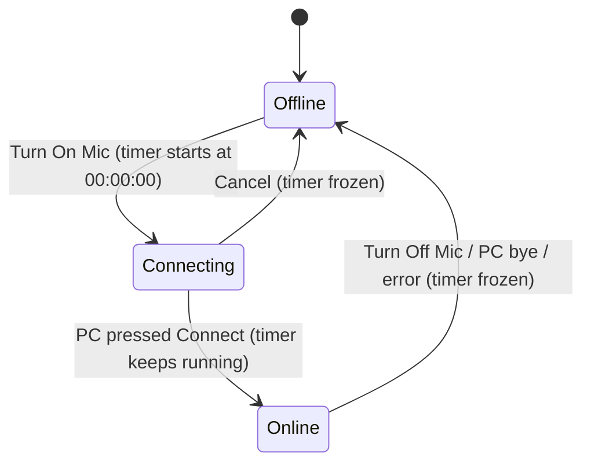
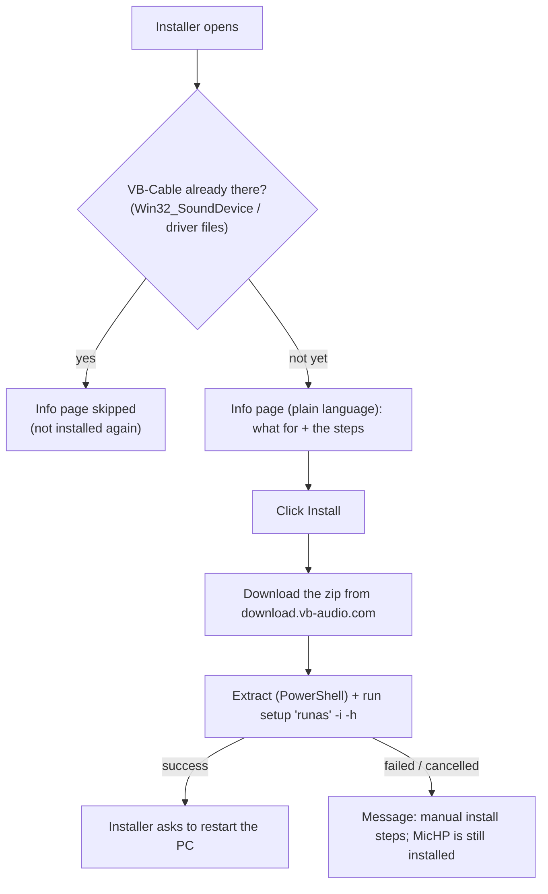

# MicHP — System Architecture Blueprint & Technical Design Document

> Document version: 1.2 · Written from the code that is in this repo (not an empty plan).
> **Verification status:** the PC side is tested automatically (63 tests: UDP loopback + fake audio + headless Chromium + asset/installer checks).
> The author also verified the whole system on real devices: the Android app, the Windows installer (including the automatic VB-Cable install),
> sound in other apps through VB-Cable, volume control, 125%+ screen scaling and the phone's screen being off.
> Parts that are still not proven are marked ⚠️ (other routers, other phones, the Edge fallback window, measured latency).

## 1. System Overview & Goals

**Problem:** existing "phone as PC mic" apps are paid or limit the duration (they switch off about every hour).

**Goal:** an Android phone becomes a microphone for a Windows PC over the same home WiFi, free, with no
time limit and no server on the internet.

**Main features**
1. Phone: a three-state button — *Mic Offline* (grey) → *Mic Connecting..* (yellow) → *Mic Online* (green).
2. PC: the phone's name shows up automatically + a **Connect** button.
3. PC: volume slider (50% = original, 100% = 2×), sound level bar, **Hear yourself** toggle.
4. The sound is forwarded to a virtual mic (VB-Cable) so it can be picked in Discord/OBS/Zoom.
5. The PC app runs as a standalone Windows app (installer), and the window position is remembered.
6. The installer **also installs VB-Cable** with no checkbox: a plain-language info page (only if VB-Cable is missing) → Install → MicHP + VB-Cable installed → restart. If it is already there, it is skipped.
7. Look: **plain** background (`#050A1E`) on phone and PC — no gradient, no glow, no grid lines.
8. Timers (format `HH:MM:SS`, counted locally on each side, **no protocol change**):
   - **PC** shows how long the phone has been connected (from the first audio packet). If the connection ends *on its own* (audio timeout, or the phone sent `bye`) the time is **frozen** and stays on screen — "Connection lost after …" / "Phone stopped after …" — until the next Connect. A manual **Disconnect** clears it.
   - **Phone** shows "Active for HH:MM:SS", which starts the moment the mic is switched on (**Turn On Mic** pressed), whether it is still Connecting or already Online. When the mic is switched off (by the user, by the PC, or by an error) the timer is **frozen** and shows "Last session HH:MM:SS" until the next start (which begins at 00:00:00).
9. The whole app (UI, installer, scripts, docs) is in English for international users.

**Out of scope (on purpose):** access over the internet, encryption, audio compression (Opus), more than one
active phone at a time, a custom audio driver, iOS, macOS/Linux, Play Store.

**Accepted security limits:** the LAN is trusted. Anyone on the same WiFi can send
`hello`, but the PC only accepts audio from the phone that was manually *Connected* (session + IP are checked).

## 2. High-Level System Architecture

### 2.1 Component diagram



### 2.2 System context (who talks to whom)



## 3. Tech Stack & Infrastructure Breakdown

| Layer | Technology | Role | Reason |
|---|---|---|---|
| Phone | Kotlin, Jetpack Compose, `AudioRecord`, `DatagramChannel` | UI, record the mic, send UDP | Native: the most stable mic access and foreground service |
| Phone (background) | Foreground service of type `microphone`, WakeLock, WifiLock | The mic stays alive with the screen off | Android kills normal background apps |
| Transport | UDP (LAN) | Discovery + audio | Low latency, no server, good for voice |
| Audio format | PCM s16le mono 48 kHz, frame of 960 samples (20 ms) | Packet contents | Simple, about 770 kbps is fine for home WiFi |
| PC core | Python 3 stdlib (`socket`, `threading`) | Discovery, receive audio, gain, level | No heavy dependencies, easy to test |
| PC audio | `sounddevice` (PortAudio), `RawOutputStream` | Output to CABLE Input + monitor | One pip package, bundles the DLLs for Windows |
| PC UI | Static HTML/CSS/JS + `ThreadingHTTPServer` (127.0.0.1) | Interface | Free design, no framework |
| PC window | `pywebview` + WebView2 (fallback: Edge/Chrome `--app`) | Standalone app window | Not a browser tab; the position can be remembered |
| Virtual mic | VB-Cable (third party, donationware) | Fake microphone device | A custom one needs a kernel driver + signing |
| Virtual mic install | Inno Setup `[Code]` script: `DownloadTemporaryFile` + PowerShell `Expand-Archive` + `ShellExec('runas')` | Download from vb-audio.com, then install the driver | It may not be bundled in the installer (VB-Audio distribution terms); download from the official site |
| Packaging | PyInstaller (onedir) + Inno Setup 6.1+/7 | `MicHP.exe` + `MicHP-Setup.exe` | Users without Python |
| Tests | `unittest`, Playwright/headless Chromium | Protocol, integration, audio, UI tests | Runs on Linux without devices |

Cloud infrastructure: **none.** Everything is local.

## 4. Data Model & Schema (ERD)

**There is no database.** All data lives only for the session (in memory) except two small files.



**Permanent storage**

| Location | Contents | Owner |
|---|---|---|
| `%LOCALAPPDATA%\MicHP\window.json` | `{x, y, width, height}` of the last window | PC |
| `%LOCALAPPDATA%\MicHP\webview\` | WebView2 internal data | PC |
| Android `SharedPreferences("michp")["id"]` | Device UUID | Phone |

**Timer state (memory only, never stored or sent)**

| Side | Fields | Meaning |
|---|---|---|
| PC (`PcCore`) | `_connected_at`, `_last_session_seconds`, `_last_session_reason` | Start of the connected timer (monotonic); frozen duration + why it ended (`lost` / `phone`) |
| Phone (`MicUiState`) | `activeSinceMs`, `frozenMs` | `elapsedRealtime()` when the mic was switched on; how long it ran when it was switched off |

## 5. API & Interface Specification

### 5.1 UDP protocol (phone ↔ PC)

| Port | Listener | Messages |
|---|---|---|
| 48100 | PC | `hello`, `bye` from the phone |
| 48101 | PC | audio packets |
| 48102 | Phone | `accept`, `bye` from the PC |

```json
{"t":"hello","v":1,"id":"<uuid>","name":"Phone name","ctrl_port":48102}
{"t":"accept","v":1,"session":123456,"audio_port":48101,"rate":48000,"ch":1,"fmt":"s16le","frame":960}
{"t":"bye","v":1,"id":"<sender id>","session":123456}
```

**Audio packet** (little-endian, 12-byte header + 1920 bytes PCM): `"WM"` · version=1 · type=1 · `session u32` · `seq u32`.

**Error handling:** non-JSON messages, `v` ≠ 1, or a wrong header → ignored (`ProtocolError`/`None`), never a crash.
Packets with a wrong session or IP → rejected and counted in `stats.rejected`.

### 5.2 Local HTTP (UI ↔ PC), `127.0.0.1:8765` only

| Method | Route | Request body | Response |
|---|---|---|---|
| GET | `/api/state` | – | full state (see below) |
| GET | `/`, `/app.js`, `/style.css`, `/logo.svg` | – | static files (file name only, no path) |
| POST | `/api/connect` | `{"id": "<device id>"}` | `{"ok": bool, "state": {...}}` |
| POST | `/api/disconnect` | `{}` | `{"ok": true, "state": {...}}` |
| POST | `/api/gain` | `{"percent": 0..100}` | `{"ok": true, "state": {...}}` |
| POST | `/api/monitor` | `{"on": bool}` | `{"ok": bool, "state": {...}}` — `ok:false` when turning on = failed to open the output |
| POST | `/api/output` | `{"index": int \| null}` | `{"ok": bool, "state": {...}}` |

`state` (short): `state` (`waiting`/`found`/`connected`), `devices[]`, `active`, `level` 0..1,
`connected_seconds` (seconds since the first audio; 0 if not connected),
`last_session_seconds` (frozen connected time of the last connection that ended on its own; `null` if there is none or while connected),
`last_session_reason` (`"lost"` = audio stopped, `"phone"` = the phone sent bye; `null` when there is no frozen time),
`gain`, `gain_percent`, `stats{received,lost,late,rejected,bytes}`,
`audio{available, error, monitor, monitor_target, monitor_shared, virtual_index, virtual_name, virtual_is_cable, devices[], underruns}`.

**HTTP errors:** `403` (Host is not 127.0.0.1/localhost:port, or a POST without the `X-MicHP: 1` header / a foreign Origin),
`400` (broken JSON/percent/index/length), `413` (body > 4096 bytes), `404`.
Device names from the network are **always** rendered with `textContent` (no XSS from a phone name).

## 6. Core Logic & Algorithm Breakdown

### 6.1 Connect (sequence)



### 6.2 PC state



### 6.3 Phone timer



### 6.4 Core pseudocode

```text
on hello(msg, addr):                      # PC
    dev = devices[msg.id] = Device(msg.name, addr.ip, msg.ctrl_port, now)
    if dev is active: re-send accept (same session)

on audio_packet(data, addr):              # PC
    pkt = unpack(data) or ignore
    if pkt.session != session or addr.ip != active.ip: stats.rejected++; return
    if first packet: connected_at = now           # PC timer starts here
    seq: higher than the last -> lost += gap-1; lower -> late++
    pcm = clip16(sample * gain)           # gain = percent / 50
    level = clamp((20*log10(rms/32768) + 60) / 60, 0, 1)
    audio.push(mono_to_stereo(pcm))

on connection ended without a PC click:   # PC (audio timeout or phone bye)
    if connected_at is set:
        last_session_seconds = now - connected_at   # frozen
        last_session_reason  = "lost" | "phone"
    clear active

on Turn On Mic (service enters Connecting):   # phone
    activeSinceMs = elapsedRealtime(); frozenMs = null

on mic ended (user / PC / error):             # phone, in MicClient's finally
    frozenMs = elapsedRealtime() - activeSinceMs
    activeSinceMs = null; status = Offline

JitterBuffer.pop(n):
    not filled to 60 ms yet -> silence
    not enough data -> fill the rest with silence, underruns++, restart the prebuffer
    data > 240 ms -> drop the oldest, overflows++
```

### 6.5 Edge cases already handled

| Case | Behaviour |
|---|---|
| `accept` is lost (UDP) | The phone keeps sending `hello`; the PC re-sends `accept` with the same session |
| The phone cancels before being Connected | The phone sends `bye(session=0)`; the phone's name disappears from the PC |
| Two phones show up | The second shows in the "others" list; Connecting to the second sends `bye` to the first |
| Output chosen = default speakers | Monitor does **not** open a second stream (prevents doubled sound); the UI warns that the sound plays directly |
| Output chosen is not "CABLE" | The UI warns: the sound does not reach the Discord mic |
| UDP/UI port already in use | If the old UI is still alive → show its window; otherwise → an error message box |
| Window position saved on a monitor that was unplugged | Ignored, the window opens at the default position |
| WebView2 missing | Falls back to an Edge/Chrome `--app` window ⚠️ (fallback not tried on a real PC) |
| Connection drops before any audio arrived | The PC timer never started, so there is nothing to freeze (no frozen time is shown) |
| PC user clicks Disconnect | The PC timer is cleared (not frozen): it was a deliberate action |
| The phone's mic is switched off while Connecting | The phone timer freezes at how long it had been running |
| The PC reconnects after a drop | The frozen time is cleared and a new session counts from 00:00:00 |
| VB-Cable already installed | The info page is skipped; no re-download/re-install; the installer summary says "already installed" |
| VB-Cable not installed | Info page → Install → MicHP installed → download → ask for Administrator → install → the installer asks for a restart |
| VB-Cable download/extract/install fails or UAC is refused | MicHP is still installed; a message box shows the manual steps; the MicHP UI shows the yellow warning "Virtual mic (VB-Cable) not found" |

### 6.6 Verified and not yet proven

**Verified on real devices by the author:** Android compilation and use on a phone (including the phone timer), the Windows installer, the automatic VB-Cable install, sound reaching other apps through CABLE Output, volume control, 125%+ screen scaling, and the phone's screen being off. Perceived result: clear sound, almost no noticeable delay.

**Not proven yet ⚠️**
1. Routers with *AP/client isolation* block the `hello` broadcast (expected, documented in the guide); other router models have not been tried.
2. Other phone brands and Android versions (aggressive battery savers may stop the mic with the screen off).
3. The Edge/Chrome `--app` fallback when WebView2 is missing.
4. Latency has not been measured with an instrument (only judged by ear).
5. `DownloadTemporaryFile` in the installer is used without a hash check (the file always comes from vb-audio.com).

### 6.7 Virtual mic install in the installer



**Why it works this way:** VB-Cable contains a signed driver owned by VB-Audio; its distribution terms (section 3.4 of the Terms of use) do not allow just anyone to bundle it, so the installer downloads it from the official site. A driver installer needs Administrator rights, while the MicHP installer itself runs without Administrator (`PrivilegesRequired=lowest`) — that is why only the VB-Cable step asks for UAC.

## 7. Directory Structure & Code Conventions

```text
michp/
├── AGENTS.md                  # instructions for AI agents
├── PROTOCOL.md                # UDP protocol specification
├── GUIDE.md                   # user guide (install, use, troubleshooting)
├── PROGRESS.md
├── docs/BLUEPRINT.md          # this document
├── branding/                  # logo (svg, ico, png); logo-small.svg = simplified glyph for icons <= 32 px
├── pc/
│   ├── michp_app.py         # .exe entry point
│   ├── build.bat, installer.iss (including the VB-Cable install), michp.ico, requirements.txt
│   ├── michp_pc/
│   │   ├── protocol.py        # constants + packet pack/unpack + JSON messages
│   │   ├── pcm.py             # level, gain, mono→stereo (no audioop)
│   │   ├── core.py            # PcCore: discovery, session, statistics, frozen timer
│   │   ├── audio_out.py       # JitterBuffer, AudioOutput
│   │   ├── webui.py           # local HTTP + security
│   │   ├── app.py             # launcher, window, geometry
│   │   ├── fake_phone.py, cli.py
│   │   └── static/            # index.html, style.css, app.js, logo.svg
│   └── tests/                 # 63 tests (including test_assets.py: plain background, square logo/icon, installer, English-only)
└── android/app/src/main/
    ├── AndroidManifest.xml
    ├── java/com/michp/      # MainActivity, MicService, MicRepository, DeviceInfo, net/, ui/
    └── res/                   # adaptive icon
```

**Conventions**
- Python: plain threads + sockets (no asyncio, safer on Windows); stdlib only except `sounddevice` and `pywebview`. Do not use `audioop` (removed in Python 3.13).
- All user-facing text is English, plain and friendly. Product name: **MicHP**. Internal identifiers (`michp_pc`, `com.michp`, the `X-MicHP` header) use the same name as the product. `test_assets.py` fails if Indonesian words come back.
- The protocol is a contract: change `PROTOCOL.md`, `protocol.py` and `net/Protocol.kt` **together**, and bump `v`.
- UI: dark-blue glass theme; colour tokens in `style.css` (`--bg #050A1E`, `--accent #2F6BF2`, green `#22C55E`, yellow `#F5B301`, grey `#4B5563`). The background is **plain**: do not add gradients, glow, or line/grid patterns (PC `style.css`, phone `MicHPScreen.kt`).
- Logo: one source `branding/logo.svg` (an identical copy in `pc/michp_pc/static/logo.svg`). The header `.logo` must stay square (`flex: 0 0 36px`, `aspect-ratio: 1/1`, no extra `border-radius`). `michp.ico` holds square frames of 16–256 px (including 20/24/28/40/56 for 125–175% DPI); ≤32 px uses a simplified glyph without the wifi waves.
- Phone: the action button (Turn On Mic / Cancel / Turn Off Mic) sits right below the status card, not at the bottom of the screen. The timer line ("Active for .." / "Last session ..") in the status card is always present (a space when there is nothing to show) so the layout does not shift. On the PC the frozen-time rows are always present too (`visibility: hidden`, never `display: none`).
- Timers use a monotonic clock (`time.monotonic()` on the PC, `SystemClock.elapsedRealtime()` on the phone), not the wall clock, so they are not affected by clock/time-zone changes.
- Local UI security: keep the Host/Origin/header checks and `textContent`.
- Every PC behaviour change must come with a test in `pc/tests/`.

## 8. Draft `AGENTS.md`

The version in force is at [`../AGENTS.md`](../AGENTS.md).
